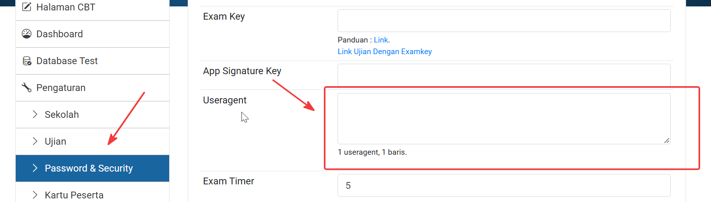
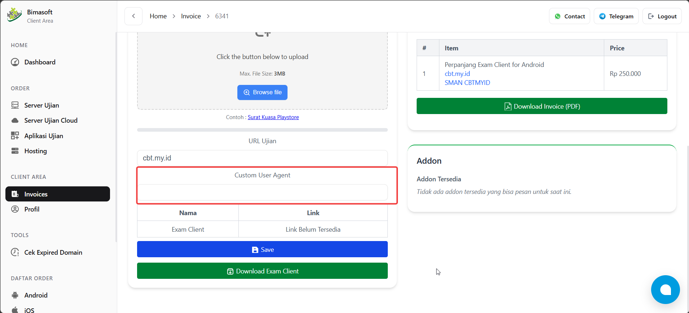
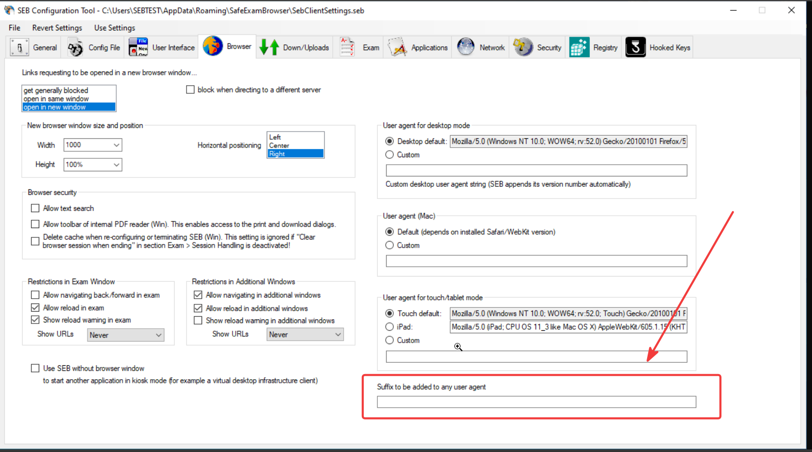

# Pengaturan Useragent Pada Examclient

Useragent digunakan apabila kita ingin mencegah agar siswa tidak bisa mengakses ujian melalui browser, sehingga siswa hanya bisa mengakses ujian melalui aplikasi yang sudah kita approve.

Pengaturan useragent bisa diatur melalui webadmin > pengaturan > security > useragent. Bisa kita isi dengan useragent yang kita inginkan, contoh : _123_.

Adapun untuk pengaturan useragent pada examclient, Setiap examclient memiliki pengaturan useragent yang berbeda-beda, berikut adalah beberapa contoh pengaturan useragent pada examclient:

## Examclient Bimasoft

Useragent pada examclient bimasoft bisa diatur melalui kotak "Custom User Agent" pada halaman invoice.

Silakan mengisi kotak input tersebut dengan useragent yang kita input padaa halaman pengaturan, contoh : _123_.

## Safe Exambrowser

Untuk Safe Exambrowser, useragent bisa diatur melalui `Suffix to be added to any user agent` pada halaman pengaturan. Silakan mengisi kotak input tersebut dengan useragent yang kita input pada halaman pengaturan, contoh : _123_.

## Multiple user agent

Ada kalanya kita ingin menggunakan beberapa jenis user agent, misalnya kita ingin menggunakan useragent _123_ untuk HP dan useragent _456_ untuk PC. Untuk itu kita bisa mengisi _123_ pada baris pertama dan _456_ pada baris kedua pada kotak input useragent yang ada pada `webadmin > pengaturan > security > useragent`, sehingga baik HP maupun PC bisa mengakses ujian melalui examclient yang sudah kita approve.
